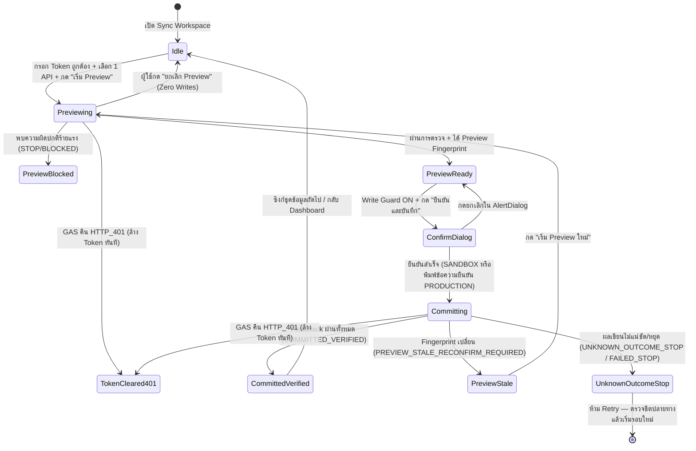

# Sync Workspace Page Overrides — ThaiPHC Data Connector

> **PROJECT:** ThaiPHC Data Connector  
> **PAGE ID:** `sync-workspace` (`พื้นที่ซิงก์ข้อมูล`)  
> **PAGE TYPE:** Single-API Guided Synchronization Workbench (Token → Select → Batched Preview → Diff/Review → Explicit Confirm → Commit & Readback)  
> **OVERRIDE LOGIC:** Rules in this file **override** [MASTER.md](../MASTER.md) for the Sync Workspace view. For all unspecified tokens, typography, icons, accessibility, and color contrast rules, follow `MASTER.md` strictly.

---

## 1. Page Purpose & Layout Overrides

The Sync Workspace guides the operator through **one deliberate, bounded, auditable Repeatable Sync at a time** (single API per run) while enforcing ephemeral Bearer Token hygiene, strict PII minimization boundaries, `Preview Fingerprint` anti-stale protection, Write Guard checks, and honest non-ACID post-write `Destination Readback`.

### Overrides from `MASTER.md`
- **Container Max-Width:** `max-w-[1280px] mx-auto` (tighter measure than Dashboard for focused step-by-step inspection and confirmation reading).
- **Sticky Offset Override (WCAG 2.2 Focus Not Obscured):** Because Sync Workspace places a **Persistent Bearer Token Bar** directly below the Global App Header on `≥1024px`, override the scroll offset token on the workspace container:
  ```css
  /* Workspace sticky compensation: Header (64px) + Token Bar (~76px) + Breathing Room (16px) */
  .sync-workspace-root {
    --sticky-scroll-offset: 9.75rem; /* 156px on lg+; 5rem on mobile where token bar is non-sticky */
  }
  ```
  *Responsive rule:* On `<1024px` (`375px` and `768px`), keep the Token Bar **in normal document flow (not sticky)** at the top of Sync Workspace so it never consumes 25%+ of vertical mobile viewport or obscures focused inputs.
- **4-Stage Linear Stepper:** Display a compact read-only progress stepper directly below the Token Bar showing current operational stage:
  1. `1. เลือกชุดข้อมูล` (Dataset Selection)
  2. `2. Preview & ตรวจผลต่าง` (Batched Read-Only Preview + Diff & Review Inspector)
  3. `3. ยืนยันและบันทึก` (Explicit Confirmation Gate + Commit)
  4. `4. ผลตรวจอ่านซ้ำ` (Destination Readback Verification Report)

---

## 2. Operational State Flow



*(Global Lifecycle Rule: If 15 minutes pass with zero user activity, the in-memory Bearer Token wipes automatically across any non-committing state and announces cleanly via `role="status"`.)*

---

## 3. Component Specifications (6 Mandatory Modules)

### Module 1: Persistent Bearer Token Bar
- **Placement:** Top of Sync Workspace (`lg:sticky lg:top-[var(--header-height)] lg:z-20`, `bg-card border border-border rounded-lg shadow-[var(--shadow-sm)] p-3.5 sm:p-4`).
- **Layout Anatomy:**
  - **Row 1 — Input & Immediate Controls (`flex flex-col sm:flex-row sm:items-end gap-2.5`):**
    1. **Token Field (`flex-1 min-w-0`):**
       - Visible `<Label htmlFor="thaiphc-bearer-token" className="flex items-center gap-1.5 text-xs font-semibold text-foreground mb-1.5">` with `KeyRound` (`size-4`). Copy: `"ThaiPHC Bearer Token (เก็บในหน่วยความจำแท็บนี้เท่านั้น)"`.
       - Relative input wrapper containing:
         - `<Input id="thaiphc-bearer-token" type={isRevealed ? "text" : "password"} autoComplete="off" autoCorrect="off" autoCapitalize="off" spellCheck={false} placeholder="วางเฉพาะค่า Token (ไม่ต้องใส่คำว่า Bearer)" aria-invalid={hasTokenError} aria-describedby="token-help token-error" className="pr-11 font-mono text-sm" />`
         - **Accessible Authentication (WCAG 2.2 AA):** **MUST allow paste (`Ctrl+V` / context menu) and password managers.** Never call `e.preventDefault()` on `onPaste`.
         - Inline Show/Hide Button positioned inside right edge (`min-w-9 min-h-9`, `aria-pressed={isRevealed}`, `aria-label={isRevealed ? "ซ่อน Bearer Token" : "แสดง Bearer Token ชั่วคราว"}`, icons `EyeOff` / `Eye`).
    2. **One-Click Clear Token Button (`shrink-0`):**
       - `<Button type="button" variant="outline" className="min-h-10 border-input text-foreground hover:bg-status-stop-bg hover:text-status-stop-fg hover:border-status-stop-border">` with `Trash2` (`size-4`) + `"ล้าง Token"`.
       - Enabled whenever token input is non-empty; wipes React memory immediately and focuses back on the token input with status confirmation.
  - **Row 2 — Ephemeral Memory & Idle Auto-Clear Status Strip (`mt-2.5 flex flex-wrap items-center justify-between gap-2 text-xs`):**
    - Left assurance text (`id="token-help"`, `text-muted-foreground flex items-center gap-1.5`):
      - `Lock` (`size-3.5 shrink-0`) + `"ไม่บันทึกลงเบราว์เซอร์ (localStorage / sessionStorage / cookie) · ใช้ซ้ำได้หลาย API ระหว่างที่เปิดแท็บนี้"`
    - Right Idle Auto-Clear Indicator (`whitespace-nowrap font-mono tabular-nums`):
      - When empty: neutral badge `"ยังไม่ได้ระบุ Token"`
      - When populated & valid: soft teal badge `"พร้อมใช้งาน · ล้างอัตโนมัติเมื่อไม่ใช้งาน 15 นาที (เหลือ MM:SS)"`
      - **Screen Reader Discipline:** Visual timer updates cleanly, while the `role="status" aria-atomic="true"` live region announces **only** on state transitions (Token ready, ≤ 2 minutes remaining warning, auto-cleared after 15 minutes idle, cleared manually, or wiped due to `HTTP_401`) — never every second.
  - **Inline Validation & `HTTP_401` Error Feedback:**
    - Inline field error (`id="token-error"`, `text-xs text-status-stop-fg font-medium mt-1.5`) triggers on blur or Preview click for:
      - Empty token → `"กรุณาวาง ThaiPHC Bearer Token ก่อนเริ่ม Preview"`
      - Starts with `Bearer ` prefix → `"กรุณาวางเฉพาะค่า Token โดยไม่ต้องใส่คำนำหน้า 'Bearer '"`
      - Malformed characters / whitespace → `"รูปแบบ Token ไม่ถูกต้อง (พบช่องว่างหรืออักขระที่ไม่รองรับ)"`
    - **`HTTP_401` Auto-Clear Alert (`role="alert"`):** Displayed directly inside/below Token Bar in crimson stop styling: `"การยืนยันตัวตนไม่ผ่าน (HTTP_401) — ระบบล้าง Token ออกจากหน่วยความจำแล้ว กรุณาวาง Token ใหม่"`. **Strictly never echo any part of the invalid token value.**

---

### Module 2: Single-API Dataset Selector (8 APIs)
- **Interaction Model:** Single-select `<fieldset>` / `role="radiogroup"` (`aria-labelledby="dataset-selector-heading"`), locked/disabled while Preview or Commit is actively running.
- **Two Distinct Visual Groups:**
  1. **Reference Datasets (`ชุดข้อมูลอ้างอิงพื้นฐาน · 3 APIs`):** `grid grid-cols-1 md:grid-cols-3 gap-3`
     - `subdistricts` · `villages` · `health-services`
  2. **Extended Report Datasets (`ชุดข้อมูลรายงานขยาย · 5 APIs · Minimized Projection`):** `grid grid-cols-1 md:grid-cols-2 lg:grid-cols-3 gap-3`
     - `volunteer-gender` · `assignments` · `volunteer-family` · `resigned-volunteers` · `volunteer-tenure`
- **Selectable Radio Card Anatomy (Native `<input type="radio" className="sr-only">` wrapped in `<label>` with `has-[:focus-visible]:ring-2 has-[:focus-visible]:ring-ring has-[:checked]:border-primary has-[:checked]:bg-primary-soft/60`):**
  - **Top Row:** Thai dataset name (`font-semibold text-sm`) + radio check indicator on right; mono endpoint slug (`font-mono text-xs text-muted-foreground`) beneath.
  - **Badge Collection (`flex flex-wrap gap-1.5 mt-2.5`):**
    - Sync Mode Badge: `Keyed Upsert` (`Database`) OR `Complete Snapshot` (`Layers`, indigo highlight on `volunteer-family`).
    - Privacy / Locality Policy Chip(s) where applicable:
      - `Minimized Projection` (all 5 report APIs)
      - `Small-Cell Suppression` (`volunteer-gender`)
      - `Preserve Source Locality` (`volunteer-family`, `resigned-volunteers`)
      - `PLACEHOLDER_COORDS Check` (`health-services`)
    - Conditional Warning Chips:
      - If dataset has `UNRESOLVED_PREVIOUS_RUN`: crimson chip `UNRESOLVED_PREVIOUS_RUN` (`OctagonAlert`)
      - If target class Write Guard is `OFF`: neutral chip `Preview เท่านั้น (Guard OFF)` (`ShieldOff`)
- **Action Footer Bar (`flex flex-col sm:flex-row sm:items-center sm:justify-between gap-3 pt-4 border-t border-border`):**
  - Left assurance caption: `Info` (`size-4 text-primary shrink-0`) + `"ขั้นตอน Preview เป็นโหมดอ่านอย่างเดียว (GET) ไม่มีการเขียนลง Google Sheets และไม่เก็บข้อมูลบุคคลลง Cache"`
  - Right Primary CTA: `<Button variant="primary" className="min-h-11 sm:min-h-10 px-5">` (`Play` icon) → `"เริ่ม Preview (อ่านอย่างเดียว)"`. Disabled if no API selected, token invalid/empty, or request in flight.

---

### Module 3: Batched Preview Progress & Cancel
- **Shown During:** Client-orchestrated sequential batch fetching (`previewDatasetBatch` → `finalizePreview`).
- **Card Anatomy (`bg-card border border-primary-soft-border rounded-lg p-5 space-y-4`):**
  - **Header Row:**
    - Left: Selected dataset Thai name + mono slug + Pagination Protocol chip (`โปรโตคอล: none | offset | assignment | report`, `font-mono text-xs`).
    - Right: Zero-Write Assurance Pill (`bg-primary-soft border-primary-soft-border text-primary-soft-foreground`): `Lock` + `"อ่านอย่างเดียว · ไม่มีการเขียนชีต"`.
  - **Progress Track:**
    - `shadcn/ui` `<Progress value={percent} />` (`h-2.5`). For single-shot `none` lookups (`subdistricts`, `villages`), display a calm subtle indeterminate bar (static fill under `prefers-reduced-motion`).
  - **Contextual Live Status (`<p role="status" aria-atomic="true" className="text-sm font-medium text-foreground font-mono tabular-nums">`):**
    - Example: `"กำลังดึงข้อมูล assignments — หน้า 12 / 158 · ดึงแล้ว 120 / 1,571 แถว (Batch ที่ 2)"`
    - Helper sub-caption: `"ส่งคำขอทีละชุดเพื่อให้อยู่ในขีดจำกัด 6 นาทีของ Google Apps Script"`
  - **Cancel Action:**
    - `<Button type="button" variant="outline" className="border-input min-h-10">` (`XCircle` icon) → `"ยกเลิก Preview"`
    - Immediately stops further client batch calls, clears partial preview state, and confirms `"ยกเลิก Preview แล้ว — ไม่มีการเปลี่ยนแปลงใน Google Sheets"`.

---

### Module 4: Diff & Review Inspector

Displayed after `finalizePreview` completes (for both passing previews and `STOP/BLOCKED` previews).

#### 4.1 Preview Fingerprint Metadata Strip
- Compact high-density strip (`bg-muted/70 border border-border rounded-lg p-3.5`):
  - Displays `endpoint`, `env` badge, `sourceTotal` (`tabular-nums`), `datasetDigest` (first 12 hex chars + Copy + Disclosure for full SHA-256), `sheetRevisionFingerprint` (first 12 chars + Copy + Disclosure), and Preview Timestamp (`Asia/Bangkok`).
  - All long hex values follow `min-w-0 truncate` inside `flex` cells with operable full-value disclosure (`wrap-anywhere`) — never hover-only tooltips.

#### 4.2 Focusable Error Summary (`STOP/BLOCKED` — Conditional, Top Priority)
- **WCAG 2.2 Focusable Error Summary Pattern:**
  - Rendered **at the very top of the Diff Inspector** whenever any hard integrity violation blocks Commit (`status === "STOP"` / `"BLOCKED"`).
  - Container uses `role="alert" tabIndex={-1} aria-labelledby="stop-summary-title"` and receives **programmatic focus (`ref.focus()`)** immediately upon Preview returning a blocker.
  - Visual style: `bg-status-stop-bg border-status-stop-border border-l-4 border-l-destructive rounded-lg p-4`.
  - Header (`h3 id="stop-summary-title"`): `OctagonAlert` (`size-5`) + `"พบข้อผิดพลาดร้ายแรง — บล็อกการบันทึกข้อมูล (STOP/BLOCKED)"`.
  - List of safe allowlisted diagnostic codes (never raw PII or stack traces), each item linking (`<a href="#diag-<index>">`) to its diagnostic detail card below:
    - Examples: `OUT_OF_GEOGRAPHIC_SCOPE` (records outside `54/5406`, or subdistrict/village mismatch on the 6 strict datasets), `DUPLICATE_SOURCE_KEY`, `MISSING_SOURCE_KEY`, `UNEXPECTED_FIELD`, `TYPE_MISMATCH`, `FORMULA_INJECTION_DETECTED` (`/^\s*[=+\-@]/`), `ASCII_CONTROL_CHAR`, `SOURCE_TOTAL_DRIFT`, `INCOMPLETE_PAGINATION`, `UNRESOLVED_PREVIOUS_RUN`, `MISSING_HMAC_KEY`.
  - Footer note: `"ไม่สามารถยืนยันการเขียนข้อมูลได้จนกว่าจะแก้ไขสาเหตุและรัน Preview ใหม่"`

#### 4.3 `LEGACY_F010_SNAPSHOT_PRESENT` Notice Banner (Conditional, Non-Blocking)
- Shown when an F010 `Legacy Snapshot` exists in `_ThaiPHCReportCurrent` for one of the 4 keyed Extended Report Datasets (`volunteer-gender`, `assignments`, `resigned-volunteers`, `volunteer-tenure`) whose Fixed Upsert Tab has not yet been initialized.
- Visual style: `bg-status-legacy-bg border-status-legacy-border border-l-4 border-l-status-legacy-fg text-status-legacy-fg rounded-lg p-4` (`role="status"`).
- Icon: `Archive` (`size-5 shrink-0`).
- Copy:
  - Heading: `"ตรวจพบแท็บ F010 Legacy Snapshot เดิม (LEGACY_F010_SNAPSHOT_PRESENT)"`
  - Body: `"การซิงก์ครั้งนี้จะเริ่มต้นแท็บ Keyed Upsert ถาวรสำหรับชุดข้อมูลนี้ โดยแท็บ Legacy Snapshot เดิมและประวัติใน _ThaiPHCReportCurrent จะยังคงอยู่ครบถ้วนและไม่ถูกลบอัตโนมัติ"`

#### 4.4 Diff Classification Counter Cards (`INSERT` / `UPDATE` / `UNCHANGED` / `REVIEW`)
- **Layout:** `grid grid-cols-2 lg:grid-cols-4 gap-3` (4-up desktop, 2×2 mobile/tablet).
- **Interactive Filter Semantics:** Each card is a native `<button type="button" aria-pressed={activeFilter === kind}>` (or `<TabsTrigger>` inside `TabsList`) with clear selected border ring (`ring-2 ring-ring`) so the operator can filter the sample table/review list by classification.
- **Card Content (Color + Icon + Mono Code + Thai Label + Tabular Count):**
  1. `INSERT` — `PlusCircle` — `"เพิ่มใหม่"` — `bg-diff-insert-bg border-diff-insert-border text-diff-insert-fg`
  2. `UPDATE` — `RefreshCw` — `"อัปเดต"` — `bg-diff-update-bg border-diff-update-border text-diff-update-fg`
  3. `UNCHANGED` — `MinusCircle` — `"ไม่เปลี่ยนแปลง"` — `bg-diff-unchanged-bg border-diff-unchanged-border text-diff-unchanged-fg`
  4. `REVIEW` — `AlertTriangle` — `"ต้องตรวจสอบ"` — `bg-diff-review-bg border-diff-review-border text-diff-review-fg`

#### 4.5 `REVIEW` Sub-Category Breakdown (Shown when `REVIEW > 0`)
- Compact `bg-diff-review-bg/60 border border-diff-review-border rounded-lg p-3.5` panel displaying `flex flex-wrap gap-2` chips with counts and plain-Thai operational rules:
  - `MISSING_IN_SOURCE`: `"พบในชีตเดิมแต่ไม่พบในต้นทาง — ระบบจะคงแถวเดิมไว้ ไม่ลบอัตโนมัติ"`
  - `LOCALITY_MISMATCH` *(strictly `volunteer-family` & `resigned-volunteers`)*: `"รหัสตำบล/หมู่บ้านไม่ตรงฐานอ้างอิงภายใน อ.สอง 5406 — คงค่าต้นทางตามกฎ Preserve Source Locality"`
  - `SMALL_CELL_SUPPRESSED` *(`volunteer-gender`)*: `"ปิดบังค่าจำนวน 1–4 เป็น null ตามกฎ Complementary Small-Cell Suppression"`
  - `PLACEHOLDER_COORDS` *(`health-services`)*: `"พบพิกัด (0, 0) ซึ่งเป็นค่าตัวแทน"`

#### 4.6 Privacy-Scoped Sample Preview Table (Dual-Mode Contract)

##### Mode A — Reference Datasets (`subdistricts`, `villages`, `health-services`)
- **Privacy Scope:** Non-person administrative/facility lookups — readable changed and sample rows are permitted.
- **Table Columns (`<Table>` inside `overflow-x-auto` on `≥768px`; stacked diff cards on `375px`):**
  1. **สถานะ (Diff):** Badge (`INSERT` / `UPDATE` / `UNCHANGED` / `REVIEW`)
  2. **`_source_key`:** `font-mono text-xs` (preserves leading zeros visually)
  3. **ชื่อ / รหัสอ้างอิง:** Thai subdistrict/village/health-service name + code
  4. **รายการเปลี่ยนแปลง (Changed Fields):**
     - For `UPDATE`: inline structured pairs `ชื่อฟิลด์: ค่าเดิม → ค่าใหม่` (old value in `line-through text-muted-foreground`, new value in `font-medium text-diff-update-fg`)
     - For `INSERT`: key summary fields
     - For `REVIEW`: specific reason badge (`MISSING_IN_SOURCE`, `PLACEHOLDER_COORDS`)
- **Empty Change State (`INSERT === 0 && UPDATE === 0 && REVIEW === 0`):** Clean informational panel (`CheckCircle2`) stating `"ข้อมูลต้นทางตรงกับปลายทางทั้งหมด (UNCHANGED) — ไม่มีความจำเป็นต้องเขียนข้อมูลใหม่"`.

##### Mode B — Extended Report Datasets (`volunteer-gender`, `assignments`, `volunteer-family`, `resigned-volunteers`, `volunteer-tenure`)
- **Mandatory Top Privacy Boundary Banner (`bg-muted border border-border border-l-4 border-l-primary rounded-lg p-3.5 mb-3`):**
  - Icon `Lock` (`size-4 text-primary shrink-0`) + Copy:
    > `"ขอบเขตคุ้มครองข้อมูลส่วนบุคคล (Minimized Projection): แสดงเฉพาะสรุปผลต่างและตัวอย่างแถวที่ผ่านการตัดข้อมูลระบุตัวตนโดยตรงจากฝั่ง GAS แล้วเท่านั้น — ไม่มีเลขบัตรประชาชน ชื่อ-สกุล ที่อยู่ หรือรหัส อสม."`
- **Aggregate Summary Block:** Count breakdown by subdistrict/village or review category (zero personal identifiers).
- **Minimized Sample Table (`<Table>` on `≥768px`, stacked cards on `375px`):**
  - Columns strictly restricted to server-returned minimized columns:
    1. **สถานะ (Diff):** Badge (`INSERT` / `UPDATE` / `UNCHANGED` / `REVIEW`)
    2. **คีย์อ้างอิง (`_source_key` / Pseudonymous Key `h1_...`):** `font-mono text-xs`, truncated (`min-w-0 truncate max-w-[180px]`) + Copy + Disclosure (for `volunteer-gender`, shows `villageCode`; for `assignments`/`resigned-volunteers`/`volunteer-tenure`, shows `h1_...`; for `volunteer-family`, shows sanitized row index/village scope)
    3. **ขอบเขตพื้นที่ (`54 / 5406` / ตำบล / หมู่บ้าน):** Non-PII geographic code(s)
    4. **ฟิลด์ที่ลดทอนแล้ว (Minimized Attributes):** Only allowlisted non-PII numeric/category fields (e.g., suppressed gender counts, tenure band/status, assignment flags)
    5. **หมายเหตุตรวจทาน (`REVIEW` Reason):** Reason code if flagged
  - **Hard Frontend Boundary:** Even if inspecting raw JSON/disclosure, UI components only render typed allowlisted fields from the minimized preview schema.

---

### Module 5: Explicit Confirmation Gate

Positioned directly beneath the Diff & Review Inspector. Bound strictly to the active `Preview Fingerprint` — any dataset switch, token wipe, or re-preview immediately resets confirmation state.

#### Gate State 1 — Locked by `STOP/BLOCKED` or Write Guard `OFF`
- Render a locked `Card` (`bg-muted/60 border-border`):
  - If `STOP/BLOCKED`: `OctagonAlert` + `"การยืนยันถูกปิดใช้งานเนื่องจากพบข้อผิดพลาด STOP/BLOCKED ด้านบน"`
  - If Write Guard `OFF` (`THAIPHC_WRITE_ENABLED === false`, or `THAIPHC_PERSON_DATA_WRITE_ENABLED === false` for Extended Reports, or missing `THAIPHC_SAME_WORKBOOK_APPROVAL`):
    - `ShieldOff` (`size-5 text-guard-off-fg`) + `"โหมดอ่านอย่างเดียว — ไม่สามารถ Commit ได้"`
    - Lists the exact GAS Script Property that is currently `OFF` (`font-mono`), reiterating `"เปิดใช้งานได้เฉพาะผ่าน Google Apps Script Project Settings > Script Properties"`
  - Primary Commit button remains `disabled` with clear `aria-describedby` explaining why.

#### Gate State 2 — Ready in `SANDBOX` Mode
- **Card Styling:** `bg-card border-2 border-env-sandbox-border rounded-lg p-5`.
- **Summary Strip:** Target Environment (`SANDBOX`), Dataset & Target Tab (`Subdistricts` / `RFamily_<runId>`), Sync Mode (`Keyed Upsert` / `Complete Snapshot`), Impact Counts (`+INSERT / ~UPDATE / =UNCHANGED / !REVIEW`), and short `Preview Fingerprint` (`font-mono`).
- **Trigger CTA:** `<Button variant="primary" className="min-h-11">` → `"ตรวจสอบและยืนยันการบันทึก (SANDBOX)"` → opens `shadcn/ui` `<AlertDialog>`.
- **`<AlertDialog>` Content (`SANDBOX`):**
  - Title: `"ยืนยันการบันทึกข้อมูลลงสภาพแวดล้อม SANDBOX"`
  - Body: Restates dataset, Sync Mode, `Preview Fingerprint`, and note `"GAS จะตรวจสอบ Fingerprint ซ้ำภายใต้ LockService ก่อนเขียนจริง และไม่ลองเขียนซ้ำอัตโนมัติ"`
  - Footer: `<AlertDialogCancel>` (`"ยกเลิก"`) + `<AlertDialogAction className="bg-primary hover:bg-primary-hover text-primary-foreground">` (`"ยืนยันบันทึกข้อมูล"`).

#### Gate State 3 — Ready in `PRODUCTION` Mode (High-Friction Danger Gate)
- **Card Styling:** `bg-env-prod-bg/40 border-2 border-destructive rounded-lg p-5`.
- **Warning Header:** `ShieldAlert` (`size-5 text-destructive`) + solid `PRODUCTION` badge + `"เขตยืนยันการเขียนข้อมูลจริง (PRODUCTION)"`.
- **Mandatory Reminders Inside Gate:**
  - Impact summary (`INSERT` / `UPDATE` / `UNCHANGED` / `REVIEW`), Sync Mode, Target Workbook & Tab, and `Preview Fingerprint`.
  - For Extended Report Datasets initializing a Fixed Upsert Tab: explicit callout reminding operator to verify `THAIPHC_HMAC_KEY_B64` matches the existing F010 key so `h1_` keys do not duplicate.
  - Non-ACID transparency note: `"การเขียนลง Google Sheets ไม่ใช่ระบบ ACID และระบบจะไม่ลองซ้ำอัตโนมัติหากผลลัพธ์ไม่แน่ชัด"`.
- **Trigger CTA:** `<Button variant="destructive" className="min-h-11">` → `"ดำเนินการยืนยันการบันทึก (PRODUCTION)"` → opens high-friction `shadcn/ui` `<AlertDialog>`.
- **`<AlertDialog>` Content (`PRODUCTION` Typed Confirmation):**
  - Title (`text-status-stop-fg flex items-center gap-2`): `ShieldAlert` + `"ยืนยันการเขียนข้อมูลลง PRODUCTION"`
  - **Required Confirmation Phrase Box (`bg-muted border border-border rounded-md p-3`):**
    - Displays exact required phrase combining environment, district `5406`, and dataset slug:
      `PRODUCTION 5406 <endpoint>` *(e.g. `PRODUCTION 5406 villages`)*
  - **Typed Input (`<Label>` + `<Input>`):**
    - Label: `"พิมพ์ข้อความด้านบนให้ตรงทุกตัวอักษรเพื่อเปิดปุ่มยืนยัน"`
    - `autoComplete="off" spellCheck={false}` with `font-mono`
    - `<AlertDialogAction variant="destructive">` stays strictly **`disabled`** until `typedValue.trim() === expectedPhrase` AND active `Preview Fingerprint` is still valid.
  - Footer: `<AlertDialogCancel>` (`"ยกเลิก"`) + `<AlertDialogAction>` (`"ยืนยันบันทึกข้อมูลลง PRODUCTION"`).

---

### Module 6: Commit Progress & Destination Readback Verification Report

#### 6.1 In-Flight Commit Progress Card
- Displayed immediately upon confirming inside `<AlertDialog>`. Locks Dataset Selector, Token Clear, and view navigation buttons to prevent accidental interruption.
- **4-Stage Sub-Stepper (Vertical on `375px`, Horizontal on `≥768px`):**
  1. `ตรวจ LockService & Preview Fingerprint`
  2. `จัดเตรียมข้อมูล / เขียนปลายทาง` *(shows `_Stage_<endpoint>_<runId>` batch progress when staging large multi-batch commits, or `RFamily_<runId>` staging for `volunteer-family`)*
  3. `อ่านตรวจซ้ำปลายทาง (Destination Readback)`
  4. `บันทึก _ThaiPHCSyncLog & ปิดงาน`
- **Live Status Region (`role="status" aria-atomic="true"`):** Announces current phase and batch progress in plain Thai.
- **Safety Caption:** `AlertTriangle` (`size-4 text-diff-review-fg`) + `"กรุณาอย่าปิดแท็บนี้ระหว่างบันทึก — ระบบไม่ลองเขียนซ้ำอัตโนมัติ (No Auto-Retry)"`.

#### 6.2 Outcome A — Verified Success (`COMMITTED_VERIFIED`)
- **Visual Spec:** `Card` with `border-status-verified-border border-l-4 border-l-status-verified-fg bg-card`.
- **Header:** `CheckCircle2` (`size-6 text-status-verified-fg`) + Badge `COMMITTED_VERIFIED` + Title `"ซิงก์และตรวจสอบ Destination Readback สำเร็จ"`.
- **Audit Metadata Strip:** `run_id` (`font-mono` + Copy), Environment badge, Destination Tab (for `volunteer-family`: published `RFamily_<runId>` + `_ThaiPHCReportCurrent` updated confirmation), Completion Timestamp (`Asia/Bangkok`).
- **Final Outcome Counts (`grid-cols-2 sm:grid-cols-4 gap-3`):** Final `INSERT`, `UPDATE`, `UNCHANGED`, `REVIEW` counts (`tabular-nums`).
- **Destination Readback Verification Checklist (`bg-status-verified-bg/60 border border-status-verified-border rounded-lg p-4`):**
  - `✓` จำนวนแถวปลายทางตรงกับยอดที่ตรวจสอบแล้ว
  - `✓` คีย์ `_source_key` ไม่ซ้ำกัน *(หรือ Verified Complete Snapshot สำหรับ `volunteer-family`)*
  - `✓` ค่า `_row_digest` / Chunk Digest ตรงกับข้อมูลที่บันทึก
  - `✓` แท็บอื่นทั้งหมดและแท็บ `ชีต1` ยังอยู่ครบถ้วนไม่ถูกกระทบ
  - `✓` ลบแท็บพักชั่วคราว `_Stage_*` หลังตรวจสอบผ่านเรียบร้อย *(แสดงเมื่อมีการใช้ Staging Tab)*
- **Next Actions:**
  - Primary Button: `"ซิงก์ชุดข้อมูลถัดไป"` (resets workspace to Step 1 while keeping active in-memory Bearer Token)
  - Secondary Outline Button: `"กลับหน้า Dashboard"` (triggers fresh `getDashboardStatus`)

#### 6.3 Outcome B — Stale Preview Stop (`PREVIEW_STALE_RECONFIRM_REQUIRED`)
- **Visual Spec:** Focusable Alert Card (`role="alert" tabIndex={-1}`, programmatic focus on arrival) styled with `bg-status-stale-bg border-status-stale-border border-l-4 border-l-status-stale-fg text-status-stale-fg rounded-lg p-5`.
- **Header:** `ClockAlert` (`size-6 shrink-0`) + Mono Code `PREVIEW_STALE_RECONFIRM_REQUIRED` (`PREVIEW_STALE`) + Title `"ข้อมูลมีการเปลี่ยนแปลงหลัง Preview — หยุดก่อนเขียนลงแท็บจริง"`.
- **Explanation:** Clearly states whether `sourceTotal`/`datasetDigest` or destination `sheetRevisionFingerprint` drifted since Preview, confirming **zero live-tab writes were applied**.
- **Single Safe Action:** `<Button variant="primary" className="min-h-11">` (`RefreshCw` icon) → `"รัน Preview ใหม่เพื่อตรวจสอบล่าสุด"` (discards stale fingerprint and starts a fresh read-only Preview). **Never retries Commit directly.**

#### 6.4 Outcome C — Unknown Outcome / Failure Stop (`UNKNOWN_OUTCOME_STOP` / `FAILED_STOP`)
- **Visual Spec:** High-Severity Focusable Alert Card (`role="alert" tabIndex={-1}`, programmatic focus on arrival) styled with `bg-status-stop-bg border-status-stop-border border-l-4 border-l-destructive text-status-stop-fg rounded-lg p-5 space-y-4`.
- **Header:** `OctagonAlert` (`size-6 shrink-0`) + Mono Code (`UNKNOWN_OUTCOME_STOP` or `FAILED_STOP`) + Title `"หยุดการทำงานทันที — ต้องตรวจสอบชีตปลายทางก่อนดำเนินการต่อ"`.
- **Critical Diagnostic Summary Box (`bg-card border border-status-stop-border rounded-md p-3.5 text-foreground text-sm space-y-1.5`):**
  - `run_id` (`font-mono` + Copy button)
  - Safe diagnostic code (e.g., `LOCK_BUSY`, `READBACK_MISMATCH`, `RPC_TIMEOUT_UNKNOWN`, `WRITE_FAILED_STOP`)
  - `_ThaiPHCSyncLog` recorded state (`STARTED` / `FAILED_STOP`)
  - Hidden Staging Tab note: `"หากรอบนี้สร้างแท็บพักชั่วคราว (_Stage_*) ระบบจะคงซ่อนแท็บไว้ในสมุดงานเพื่อให้ตรวจสอบ ไม่ลบทิ้งอัตโนมัติ"`
  - Explicit No Auto-Retry notice: `"ระบบไม่ลองเขียนซ้ำอัตโนมัติ (No Auto-Retry) เพื่อป้องกันข้อมูลซ้ำซ้อนหรือเสียหายบน Google Sheets"`
- **Structured 3-Step Operator Recovery Guide (`<ol className="list-decimal pl-5 space-y-2 text-sm">`):**
  1. เปิดสมุดงาน Google Sheets ปลายทาง ตรวจสอบแท็บข้อมูลของชุดนี้และแถว `run_id` ล่าสุดใน `_ThaiPHCSyncLog`
  2. ตรวจสอบว่ามีแท็บซ่อน `_Stage_<endpoint>_<runId>` ค้างอยู่หรือไม่ และตรวจสอบความครบถ้วนของข้อมูลจริง
  3. กลับไปหน้า Dashboard เพื่อรีเฟรชสถานะ จากนั้นเริ่มรอบ **Preview → Diff → Confirm** ใหม่ตั้งแต่ต้น
- **Allowed Actions (Strictly NO "Retry Commit" Button):**
  - Outline Button: `"กลับหน้า Dashboard เพื่อตรวจสถานะ"`
  - Secondary Button: `"ล้างผลลัพธ์และเริ่ม Preview ใหม่"` (only resets UI to Step 1 — never re-invokes Commit)

---

## 4. Responsive & Accessibility Checklist (Sync Workspace)

- **`375px` (Mobile / Narrow GAS Iframe):**
  - Token bar sits in normal flow (non-sticky); Token input and "ล้าง Token" stack cleanly with `min-h-11` touch targets.
  - 4-Stage Stepper compresses to active stage label + step fraction (`ขั้นตอน 2 / 4: Preview & ตรวจผลต่าง`).
  - Dataset Selector renders single-column radio cards; Diff counters render 2×2 grid; Sample Preview renders stacked cards (no horizontal viewport overflow).
  - Confirmation `<AlertDialog>` uses `w-[calc(100%-1.5rem)] max-h-[85vh] overflow-y-auto` so typed confirmation input and action buttons remain reachable on small viewports.
- **`768px` (Tablet):**
  - 2-column Dataset Selector and 2×2 Diff counters; Sample Preview uses semantic `<Table>` inside `overflow-x-auto`.
- **`1024px` – `1440px` (Laptop / Desktop):**
  - Token Bar sticks cleanly below Global Header with `scroll-padding-top: 9.75rem`; 3-column Dataset Selector and 4-column Diff Counter bar; full-width Preview table.
- **Keyboard Focus Continuity:**
  - On `STOP/BLOCKED` Preview → focus moves to Focusable Error Summary (`tabIndex={-1}`).
  - On `PREVIEW_STALE_RECONFIRM_REQUIRED` or `UNKNOWN_OUTCOME_STOP` → focus moves to the Stop Alert card (`tabIndex={-1}`).
  - On `<AlertDialog>` close/cancel → focus returns cleanly to the Confirmation Gate trigger button.
  - On `HTTP_401` token wipe → focus moves to the Bearer Token input so the operator can paste a fresh token immediately.
